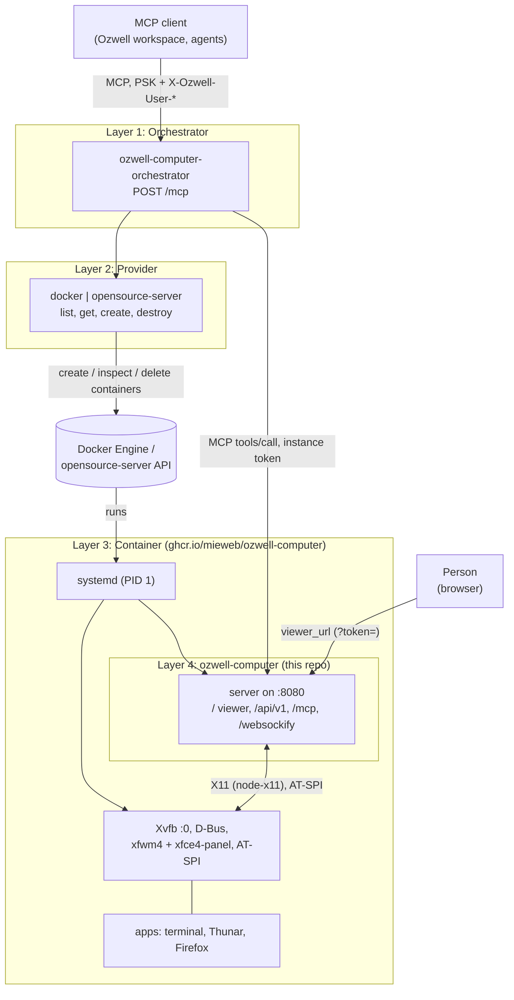

# ozwell-computer

One HTTP port that serves an X11 desktop to people and to agents:

- `/`: a noVNC viewer for humans, with presence cursors, local clipboard sharing and special keys
- `/api/v1/*`: JSON API for screenshots, input, windows, clipboard, accessibility, processes and files (Swagger UI at `/api/docs`, OpenAPI at `/api/docs/json`)
- `/mcp`: an MCP server (Streamable HTTP) with the same capabilities as tools

The VNC server is written in TypeScript and runs in-process; it talks to X through
[node-x11](https://github.com/sidorares/node-x11). It needs no x11vnc, websockify or
xdotool. The design takes ideas from [CUA](https://github.com/trycua/cua) but is not
wire-compatible with it.

## Architecture

The suite has four layers. The orchestrator manages a computer's lifecycle (create,
list, destroy) through the provider, but talks to the ozwell-computer server directly
for readiness checks (`GET /health`) and proxied MCP tool calls. A deployment therefore
needs network access from the orchestrator to both the provider API and every computer.
The lower layers work on their own: you can run the container (layer 3) without an
orchestrator, or the server (layer 4) without the container.



1. **Orchestrator** ([orchestrator/](orchestrator/README.md)): the single MCP endpoint
   most clients use. It is stateless and per user: it adds `list_computers`,
   `create_computer`, `get_computer` and `destroy_computer`, and proxies every
   ozwell-computer tool with an extra `instance_id`. It authenticates Ozwell with a
   pre-shared key and scopes every call to `X-Ozwell-User-Id`.
2. **Provider** ([orchestrator/src/providers/](orchestrator/src/providers/types.ts)): the
   adapter to a computer runtime, selected by `PROVIDER_URI`'s scheme. It implements
   `list(owner)`, `get(id)`, `create({ owner, displayName })` and `destroy(id)`, and keeps
   all state (owner, metadata, URLs, token) on the containers themselves. `docker` and
   `opensource-server` are built in.
3. **Container** ([Dockerfile](Dockerfile)): the standard runtime for one computer.
   systemd runs as PID 1 and starts the package's units: the session D-Bus, `Xvfb :0`,
   the XFCE session (xfwm4, panels, AT-SPI) and the server, all as the `desktop` user.
   The token arrives as `OZWELL_COMPUTER_TOKEN`; port 8080 is the only one exposed.
4. **ozwell-computer** ([src/](src/server.ts)): the core of this repository. One HTTP
   port serves the noVNC viewer for people, the JSON API and the MCP server for agents,
   all behind one access token. It talks to X directly and runs the VNC server
   in-process.

## Run the container

For local macOS development, see [macOS with OrbStack](#macos-with-orbstack).

```bash
docker run -d -p 8080:8080 \
  --tmpfs /run --tmpfs /run/lock -v /sys/fs/cgroup:/sys/fs/cgroup:rw --cgroupns=host \
  -e OZWELL_COMPUTER_TOKEN=$(openssl rand -hex 24) \
  ghcr.io/mieweb/ozwell-computer:latest
```

Inside the container, the `desktop` user has passwordless sudo. Prefer Podman with
`--userns=auto` so container root isn't host root; see
[Security: sudo and user namespaces](#security-sudo-and-user-namespaces).

Open `http://localhost:8080/?token=<token>`. The server sets an HttpOnly cookie and
redirects, which removes the token from the address bar.

If you don't set a token, the server generates one, stores it in
`/var/lib/ozwell-computer/token` (mount a volume there to keep it), and prints a link
with the token embedded at startup. Run with `-t` to see it in `docker logs`; that's
how `docker compose up` shows it. A token you configure yourself is never printed.

The image is based on `ghcr.io/mieweb/opensource-server/nodejs`, with systemd as PID 1,
and installs the `ozwell-computer` Debian package (below) plus a few sample apps. The
package provides these units, both running as the `desktop` user:

| Unit | Purpose |
|---|---|
| `ozwell-computer-desktop.service` | `xinit /etc/X11/Xsession startxfce4 -- Xvfb :0 ...` at `$OZWELL_COMPUTER_SCREEN`, in a PAM login session (`/etc/pam.d/ozwell-computer`: Debian's `common-account` and `common-session`), so `pam_systemd` starts the user's session D-Bus at `/run/user/<uid>/bus`. The session is xfce4-session running xfwm4, xfdesktop (a plain backdrop, set in `/etc/xdg/xfce4/xfconf/xfce-perchannel-xml/xfce4-desktop.xml`) and `xfce4-panel` (a top bar with an Applications menu and clock, and a bottom dock with launchers and running apps). It also starts the AT-SPI bus and, on first start, a terminal (xfce4-terminal); Thunar is the file manager. |
| `ozwell-computer.service` | this server (`Requires=` the desktop) |

Apps launched through the API share the session bus (`DISPLAY=:0`, and the server sets
`XDG_RUNTIME_DIR`/`DBUS_SESSION_BUS_ADDRESS` from its UID) and have the GTK/Qt
accessibility bridges enabled, so their UI shows up in `/api/v1/a11y/*`.

**The desktop persists.** Restarting, upgrading or crashing the server leaves the
desktop running; the server reattaches to the display, and open apps stay open. When
the desktop itself stops (container or machine restart, `systemctl restart
ozwell-computer-desktop`) it logs out, and xfce4-session saves the session
(`SaveOnExit`). The next start restores session-aware apps (those started from the panel or
dock, such as xfce4-terminal, Thunar and Firefox) with their window positions. Firefox
reopens its previous tabs (`docker/firefox/policies.json`). Apps launched through the
API aren't session clients and aren't restored. The session lives in the `desktop`
user's home (`~/.cache/sessions`), so it survives `docker restart` but not a new
container.

Container-only adjustments live in `docker/` and are applied by the `Dockerfile`, not
the package. They include passwordless sudo for `desktop` (see the security section
below); `docker run -e` values reach the services through the base image's
`environment.service`, and systemd's own output is kept off the console so
`docker logs` shows only the server.

## Security: sudo and user namespaces

**The container image gives the `desktop` user passwordless sudo.** Everything the
server runs as `desktop`, so this extends to `/api/v1/exec`, the terminal (PTY), MCP's
`run_command`, and apps launched through the API. Agents and users can therefore
install software or change system settings on demand. This is deliberate: an instance
is a disposable workstation for one person and one agent.

The consequence is that **anyone holding the access token, and any agent driving the
desktop, is root inside the container.** That includes an agent manipulated by a web
page it reads. Treat the token as root credentials for the instance, and use
`OZWELL_COMPUTER_EXEC=false` where agents should have less access. The rules live in
`docker/` (`sudoers.d/ozwell-computer` and a drop-in that lifts the server unit's
`NoNewPrivileges`). The Debian package grants no sudo.

### Run in a user namespace (recommended)

A user namespace maps root inside the container to an unprivileged host uid, as in
Proxmox's unprivileged LXCs. Container root keeps full control *of the container*. But
it can't create devices, mount filesystems, or write the host's cgroups, and files it
creates are owned by an unprivileged uid on the host. A container or kernel escape then
lands as that unprivileged uid, not host root.

**Podman (recommended).** It runs systemd containers in a user namespace natively.
Either pass `--userns=auto`:

```bash
podman run -d --userns=auto --systemd=always -p 8080:8080 ghcr.io/mieweb/ozwell-computer:latest
```

or make it the default for every container (including `docker compose` against
Podman's socket) in `/etc/containers/containers.conf`:

```ini
[containers]
userns = "auto"
```

`--userns=auto` needs a subordinate ID range for the `containers` user. Add this to
`/etc/subuid` and `/etc/subgid` once:

```
containers:2147483647:2147483648
```

With that setup systemd reports `running`, every service starts, and the integration
suite passes. Container root appears on the host as uid 2147483647.

**Docker can't do this for this image.**
- Docker has no per-container user namespace (`--userns` accepts only `host`).
- Its daemon-wide `"userns-remap"` in `daemon.json` prevents systemd from starting
  ("Failed to allocate manager object: Permission denied"). Docker doesn't hand the
  container's cgroup to the remapped root, and no `docker run` flags work around it.
- So on Docker the container runs with root equal to host root, plus the read-write host
  cgroup mount systemd needs, which is the `compose.yml` default.
- Use Podman where container root must not be host root. The Sysbox runtime
  (`--runtime=sysbox-runc`) is designed for systemd containers in user namespaces under
  Docker, but hasn't been tested with this image.

`compose.yml` uses the same settings for both runtimes and never fails because a user
namespace is missing. On Podman with `userns = "auto"` it runs namespaced; on Docker it
runs unnamespaced. The host cgroup mount in `compose.yml` is harmless under Podman's
user namespace, because the remapped root can't write the host's cgroups.

### Docker inside a Proxmox LXC

Proxmox's LXCFS makes the LXC's `/proc/meminfo`, `/proc/cpuinfo` and friends show the
LXC's limits. Docker gives each container a fresh `/proc` from the kernel, so inside the
container `free`, `top` and `nproc` show the whole physical host. The LXC's cgroup limits
still apply; only the reported values are wrong. That misleads anything that sizes
itself from `/proc/meminfo`.

`compose.yml` bind-mounts the LXCFS-backed files read-only into the container:
`/proc/{cpuinfo,diskstats,loadavg,meminfo,slabinfo,stat,swaps,uptime}` and
`/sys/devices/system/cpu`. On hosts without LXCFS they show the host's real values. With
plain `docker run`, add the same mounts:

```bash
-v /proc/cpuinfo:/proc/cpuinfo:ro -v /proc/diskstats:/proc/diskstats:ro \
-v /proc/loadavg:/proc/loadavg:ro -v /proc/meminfo:/proc/meminfo:ro \
-v /proc/slabinfo:/proc/slabinfo:ro -v /proc/stat:/proc/stat:ro \
-v /proc/swaps:/proc/swaps:ro -v /proc/uptime:/proc/uptime:ro \
-v /sys/devices/system/cpu:/sys/devices/system/cpu:ro
```

Also consider `--memory` a little below the LXC's allocation, so the container has its
own enforced limit and an out-of-memory kill stays inside it.

**Kubernetes:** `hostUsers: false` in the pod spec requests a user namespace on clusters
and runtimes that support it. This hasn't been tested with this image.

## Debian package

`ozwell-computer_<version>_<arch>.deb` installs the app under `/opt/ozwell-computer`,
the systemd units, `/usr/bin/ozwell-computer`, and the desktop configuration
(`/etc/xdg/...`). Settings go in `/etc/default/ozwell-computer`.
- It needs Node.js 24 or newer from NodeSource, which provides the `nodejs` package.
- Installing it creates the `desktop` user, then enables and starts the services.
- Upgrading restarts only the server, so applications open on the desktop survive.
  Upgrading from a version with separate Xvfb, D-Bus and session units replaces them
  with `ozwell-computer-desktop.service`, which restarts the desktop once (`make install`
  does the same for the git channel below).
- Removing it stops and disables the services; purging also deletes
  `/var/lib/ozwell-computer`.

```bash
make deps               # npm ci
make build              # npm run build
make install DESTDIR=/tmp/stage PREFIX=/opt/ozwell-computer   # stage the files
make deb                # stage into .pkg/buildroot (or DESTDIR=...) and run fpm
docker buildx build --target deb --output type=local,dest=out .   # .deb without local fpm
```

Package metadata and dependencies are in `.fpm`. The maintainer scripts and units
are in `contrib/`.
- **Versions come from git tags** (`./package-version deb`): `v1.2.3` gives `1.2.3`,
  3 commits later `1.2.3+3.g<hash>`, `v1.3.0-rc1` gives `1.3.0~rc1`, and no tag gives
  `0.0.0`.
- **Releases:** publishing a GitHub release builds the `.deb`, attaches it to the
  release with flat APT repository metadata (`Packages`, `Packages.gz`), and pushes the
  image with that version. The latest release is therefore an apt source; the image
  ships it as `/etc/apt/sources.list.d/ozwell-computer.sources`:

  ```
  deb [trusted=yes] https://github.com/mieweb/ozwell-computer/releases/latest/download/ ./
  ```

  Until the first release is published, `apt-get update` reports a 404 for this
  source.
- **In-app updates** come from one of two channels, set by `OZWELL_COMPUTER_UPDATE_URL`:
  - **release** (release images, the `.deb`): every 6 hours the server compares the
    installed package version with the newest one in the `Packages` index.
  - **main** (`ghcr.io/mieweb/ozwell-computer:main`): every minute the server compares
    the commit it was built from (`$PREFIX/REVISION`, written by `make install`) with
    the head of the branch (`git ls-remote`), so a push to `main` is offered within
    about a minute. CI builds these images with `--build-arg UPDATE_CHANNEL=main`,
    which adds the build toolchain (git, make, python3, g++), a checkout of the
    image's commit in `/usr/src/ozwell-computer`, and
    `OZWELL_COMPUTER_UPDATE_URL=git+https://github.com/mieweb/ozwell-computer.git#main`
    in `/etc/default/ozwell-computer`, and leaves out the apt source.

  When something newer exists, the viewer toolbar shows an "Update to X" button.
  - `GET /api/v1/update` reports versions and upgrade progress,
    `POST /api/v1/update/check` checks now, and `POST /api/v1/update/apply` upgrades.
    Nothing is installed until someone applies it.
  - The server can't upgrade itself, so applying writes
    `/var/lib/ozwell-computer/upgrade-request`. The packaged root unit
    `ozwell-computer-upgrade.path` sees it and runs `ozwell-computer-upgrade`, logging
    to `upgrade.log` beside it. The unit reads the channel from its own environment
    (`/etc/default/ozwell-computer`, and `/etc/environment` in the image), never from
    the request.
  - release: `apt-get install --only-upgrade ozwell-computer`. apt installs whatever
    version its configured sources offer.
  - main: fetch the branch into `/usr/src/ozwell-computer` (cloning it if missing),
    then `make deps build`, `make system-deps` (`apt-get install` of the packages listed
    in `.fpm`), and, only if those succeeded, `make install`. A failed
    build leaves the installed version in place. `make install` keeps existing
    config files (`/etc/default/ozwell-computer`, the xfconf defaults).
  - **Security:** a `:main` image runs `npm ci` and the build of whatever is on `main`
    as root when someone applies an update. It trusts the `main` branch (and its
    npm dependencies) as much as the image itself. Use a release image, or set
    `OZWELL_COMPUTER_UPDATE_URL=off`, where that's not acceptable. (A release
    `Packages` URL alone isn't enough on a `:main` image: it has no apt source, so
    apt would never install the release it reports; restore
    `/etc/apt/sources.list.d/ozwell-computer.sources` as above too.)
  - Upgrades restart only the server; the viewer reconnects and apps on the desktop
    stay open.
  - apt and dpkg run inside `ozwell-computer-upgrade.service`, so maintainer scripts
    must never stop or restart that service; a unit test enforces this.
  - An upgrade restarts the watcher (`.path`), so changes to it take effect at once.
    A changed upgrade script or service is used from the next upgrade.
  - The service has no start timeout, and apt waits up to 10 minutes for the dpkg lock.
    Each run first completes any earlier run that was interrupted
    (`dpkg --configure -a`). An interrupted run is reported as `failed`; retrying
    it repairs it.
- **Toolbar metrics:** the viewer polls `/api/v1/metrics` (Prometheus text format)
  every 5 s and shows container CPU, memory (against the limit, if any) and VNC
  throughput.

## Run without Docker

```bash
npx @mieweb/ozwell-computer                          # attach to $DISPLAY, bind 127.0.0.1:8080
npx @mieweb/ozwell-computer --spawn-xvfb --display :99 # headless desktop for development (needs Xvfb)
```

When no token is configured, one is generated and stored in
`~/.config/ozwell-computer/token`, and a one-time access URL is printed to stderr.

## Configuration

| Variable / flag | Default | |
|---|---|---|
| `OZWELL_COMPUTER_PORT` / `--port` | `8080` | |
| `OZWELL_COMPUTER_HOST` / `--host` | `0.0.0.0` in a container, otherwise `127.0.0.1` | |
| `OZWELL_COMPUTER_TOKEN` / `--token` | generated | Pre-shared key |
| `OZWELL_COMPUTER_TOKEN_FILE` | `/var/lib/ozwell-computer/token` (container) or `~/.config/ozwell-computer/token` | Where a generated token is kept |
| `OZWELL_COMPUTER_PUBLIC_URL` / `--public-url` | derived | Base URL used in the startup link (for example the host port behind Docker) |
| `OZWELL_COMPUTER_UPDATE_URL` / `--update-url` | the latest GitHub release's `Packages` (`git+https://github.com/mieweb/ozwell-computer.git#main` in `:main` images) | APT `Packages` index checked for new releases (`https://` or `file://`), or `git+https://<repo>#<branch>` to build that branch from git; `off` disables update checks |
| `OZWELL_COMPUTER_OPEN` / `--open` | `false` | Open the viewer in the default browser at startup |
| `OZWELL_COMPUTER_FRAME_ANCESTORS` / `--frame-ancestors` | none | Origins, space or comma separated (`https://app.ozwell.ai https://*.example.com`), allowed to embed the viewer in an iframe, via CSP `frame-ancestors`. The viewer is always frameable by its own origin |
| `OZWELL_COMPUTER_CPUS` / `--cpus` | detected | CPU capacity the toolbar's CPU % is relative to (`ozwell_cpus`). Detected from cgroup `cpu.max` and CPU affinity; set it when the limit sits outside the container's view, e.g. a Proxmox LXC `cpulimit` around a Docker host |
| `OZWELL_COMPUTER_AUTH_DISABLED` / `--no-auth` | `false` | Logs loud warnings |
| `DISPLAY` / `--display` | `:0` | |
| `OZWELL_COMPUTER_SPAWN_XVFB` / `--spawn-xvfb` | `false` | Development only |
| `OZWELL_COMPUTER_SCREEN` / `--screen` | `1920x1080x24` | |
| `OZWELL_COMPUTER_VIEW_ONLY` / `--view-only` | `false` | VNC viewers can't send input |
| `OZWELL_COMPUTER_A11Y` / `--a11y` | `auto` | `auto`, `on` or `off` |
| `OZWELL_COMPUTER_EXEC` / `--no-exec` | `true` | Controls the process, PTY, file and app-launch APIs |
| `OZWELL_COMPUTER_VNC_BACKEND` / `--vnc-backend` | `builtin` | `external:[host:]port` proxies to another VNC server, such as x11vnc |
| `OZWELL_COMPUTER_FS_ROOT` / `--fs-root` | `/` | Root directory for the file API |
| `OZWELL_COMPUTER_LOG_LEVEL` / `--log-level` | `info` | |

## Authentication

The server accepts any one of these credentials, checked in this order:
`?token=`, `Authorization: Bearer`, `X-Auth-Token`, or the `ozwell_computer_token`
cookie. WebSocket upgrades (`/websockify`, `/api/v1/pty`) follow the same rules.

Only these paths are exempt: `GET /health`, the static assets under `/novnc/*` and
`/static/*`, and HMAC-signed `/files/*` URLs. Tokens and signatures are redacted from
logs.

There is one key and one role, so anyone holding the token has full control. Put TLS
in front of the server, and use `OZWELL_COMPUTER_EXEC=false` or `--view-only` when less
access is appropriate.

## API quick tour

```bash
T="Authorization: Bearer $TOKEN"; B=http://localhost:8080/api/v1
curl -H "$T" "$B/screenshot?max_dimension=1280" -D - -o s.png     # note X-Screenshot-Id
curl -H "$T" "$B/screenshot?window=0x1a00004&ocr=true"             # JSON with image_base64 and OCR text
curl -H "$T" -H 'content-type: application/json' \
  -d '{"action":"click","x":640,"y":360,"screenshot_id":"<id>"}' $B/input/pointer
curl -H "$T" -H 'content-type: application/json' \
  -d '{"action":"type","text":"hello"}' $B/input/keyboard
curl -H "$T" $B/windows
curl -H "$T" -H 'content-type: application/json' -d '{"role":"button","name":"OK"}' $B/a11y/find
curl -N -H "$T" $B/events                                           # SSE: windows, clipboard, presence, jobs
```

- **Coordinates:** `space` is one of `screen`, `window`, `screenshot` or `normalized`.
  Screenshot coordinates are scaled back to screen pixels. If the screen or window
  geometry has changed since the capture, the request fails with `409 stale_geometry`.
- **Errors:** every error has the shape
  `{"error":{"reason","message",...}}`. The reasons are listed in `src/errors.ts`, and
  MCP tool errors use the same codes.
- **Delivery:** XTEST input always goes to the foreground, so a request with
  `delivery: "background"` returns `422 would_require_activation`. Accessibility
  actions (`/a11y/act`) don't move the pointer.
- **Agent presence:** send `X-Principal: {"id","name","kind":"agent"}` on input calls
  and the agent's cursor appears in the viewer.
- **Light/dark theme:** `PUT /desktop/theme {"scheme":"dark"}` switches the desktop's
  GTK, window and panel theme (Adwaita / Adwaita-dark apps and panel, Greybird /
  Greybird-dark window borders, set live through xfconf); `GET`
  returns `{scheme, set}`. The first viewer to connect
  sends its browser's `prefers-color-scheme` with `if_unset: true`, so later viewers
  don't change it. The toolbar's Light/Dark button switches the viewer and desktop.

## MCP

Point any MCP client at `http://host:8080/mcp` with header
`Authorization: Bearer <token>`. Each session appears as an agent participant in the
viewer.

The tools are: `screenshot`, `click`, `double_click`, `move`, `drag`, `scroll`,
`type_text`, `press_key`, `hotkey`, `list_windows`, `activate_window`, `launch_app`,
`get_ui_tree`, `find_element`, `ui_action`, `get_clipboard`, `set_clipboard` and
`update_computer`. When exec is enabled, `run_command`, `read_file` and `write_file` are
also available.

**Updates:** while the last update check found a newer version that isn't being
installed yet, every tool result ends with a text item saying so and asking the agent
to call `update_computer` before its next turn that uses the computer (it may finish the
current task first). The tool doesn't run a check itself. `update_computer` requests the
upgrade (like `POST /api/v1/update/apply`) and returns at once; the server restarts once
the update is installed, so tool calls fail briefly and should be retried.

**Long-running commands:** `run_command` waits up to `wait_ms` (default 25 s, max 50 s,
under typical 60 s MCP client timeouts). If the command finishes, it returns the result.
Otherwise it returns `state: "running"` with a `job_id` and the command keeps going;
`command_output(job_id)` waits again and returns new output (pass the returned offsets)
or the final result, and `cancel: true` stops it. `timeout_ms` (default 1 h) kills it.
Jobs run detached under `/var/lib/ozwell-computer/jobs/`, survive server restarts, and
are removed 24 h after finishing. Over HTTP, `POST /api/v1/exec` with `wait_ms` returns
`202` and a `job_id` for `GET`/`DELETE /api/v1/exec/jobs/:id`; `GET /api/v1/exec/jobs`
lists them and `GET /api/v1/exec/jobs/:id/stream` tails their output as server-sent
events. Starts and finishes are also published as `job` events on `/api/v1/events`, and
removals as `job.removed`. That stream can also carry one job's output: `PUT
/api/v1/events/:stream_id/job` (with the `stream_id` from its `hello` event) makes it send
`job.output`, `job.state` and `job.end` events for that job.
The viewer's **Jobs** toolbar button shows them with live output (over that one stream) and a
Cancel button (hidden in view-only mode).

## Development

`compose.yml` is the dev container. It uses the production image and systemd layout,
with your local `./dist` mounted over `/opt/ozwell-computer/dist`.
On macOS, apply the [OrbStack override](#macos-with-orbstack) before starting it.

```bash
nvm use                 # Node 26 (.nvmrc); the container runs the base image's Node 24
make deps               # npm ci
make build              # ./dist must exist before the first `docker compose up`
docker compose up       # prints "open http://localhost:8080/?token=…" (use -d, then
                        # `docker compose logs`, to run it in the background)
npm run watch           # rebuild on save; restarts the server in the container (about 1 s);
                        # viewer JS/CSS changes need only a page reload
npm test                # full regression: unit + integration (API, VNC, MCP, a11y,
                        # Chromium and Firefox viewer tests) against the compose service
```

- `npm test` builds `./dist` and installs Playwright's Chromium and Firefox if
  missing. It then starts the compose service if it isn't running, or restarts the
  server inside it if it is, and leaves the service running.
- **Startup link:** when no `OZWELL_COMPUTER_TOKEN` is set, the server generates a
  token and keeps it (compose stores it in the `state` volume, which survives
  `down` but not `down -v`). Every start then prints a link with the token
  embedded. A token you configure (environment or `.env`) is never printed.
- **`npm start`** runs the server on this host against `$DISPLAY` and opens the link
  in your default browser.
  - It reuses the compose service's generated token when that service is running.
  - It moves to port 8081 if compose is already on 8080.
- **Coverage guard:** a full integration run fails if any documented API route never
  returned a 2xx, or any MCP tool was never called. It reads the server's own counters
  from `/api/v1/metrics`, so new routes and tools need a test. Runs filtered to some files or tests skip
  the check.
- `npm run test:unit` runs only the fast unit tests; `npx vitest run --project
  integration test/integration/<file>` runs one integration file.
- **CI:** pushes and pull requests run typecheck, unit tests and the build (docs-only
  changes are skipped). The image build, full integration suite, `.deb` and publishing
  run on published releases, nightly, and on demand (`gh workflow run CI`). Releases
  push the version tag and `:latest`; nightly and on-demand runs push `:main`.
- `OZ_URL=… OZ_TOKEN=… npm test` runs the suite against any other server.
- Run `docker compose up -d --build` after changing anything packaged other than
  `./dist`: `contrib/` (units, XFCE config, maintainer scripts), `.fpm`, `docker/`, the
  `Dockerfile`, or dependencies. The image is rebuilt from a fresh `.deb`.
- The compose container mounts `./dist` read-only, so don't `dpkg -i` or `apt` the
  package inside it. Use `docker compose up -d --build` instead.
- Don't delete the `dist` directory itself (`rm -rf dist`) while the container is
  running. The bind mount stays attached to the old directory; run
  `docker compose up -d --force-recreate` if you do. Rebuilding into `dist`, or
  emptying it, is fine: until `dist/cli.js` exists the service logs a hint and keeps
  retrying.
- If port 8080 is taken, set `OZWELL_COMPUTER_HOST_PORT` in a `.env` file. The tests
  discover the port and token from compose.
- The compose container mounts `./dist` read-only, so an in-app upgrade there fails
  to replace it, and update checks are off there (`OZWELL_COMPUTER_UPDATE_URL`
  defaults to `off`; set it in your shell or `.env` to test the update endpoints).
  Test upgrades in a container started with `docker run`.

### macOS with OrbStack

OrbStack runs the Linux container; **Xvfb inside the container creates the virtual
display**. XFCE and Firefox run on that display, and your Mac's browser views it
through noVNC. This needs no XQuartz or additional macOS monitor. Each container
has one desktop shared by its viewers and agents.

Start OrbStack and use Docker Compose **2.24.4 or newer**. From the repository root:

```bash
nvm use
export DOCKER_CONTEXT=orbstack
export COMPOSE_FILE=compose.yml:compose.mac.yml

npm ci
npm run build
docker compose up -d --build --wait --wait-timeout 180
docker compose logs ozwell-computer
```

Open the token-bearing link from the logs in your browser. If you configured a
token yourself, use `http://localhost:8080/?token=<token>` instead. Set
`OZWELL_COMPUTER_HOST_PORT` in `.env` if port 8080 is already taken, and use that
port in the URL.

The checked-in [compose.mac.yml](compose.mac.yml) captures two requirements found
while testing on an Apple Silicon Mac:

- **AMD64 emulation.** The base image currently has no ARM64 variant. Setting
  `platform: linux/amd64` selects OrbStack's [Intel emulation](https://docs.orbstack.dev/docker/#intel-x86-emulation)
  for both building and running; no separate `DOCKER_DEFAULT_PLATFORM` export is
  needed. The first image build can be slower under emulation.
- **Remove the Linux resource bind mounts.** The base Compose file includes
  `/proc/*` and `/sys/devices/system/cpu` mounts for LXCFS resource reporting. On
  OrbStack, startup failed with `error while creating mount source path
  '/proc/slabinfo': mkdir /proc/slabinfo: no such file or directory`. The override
  replaces the volume list, keeping the cgroup mount needed by systemd, the token
  state volume and the read-only `./dist` mount. It uses [`!override`](https://docs.docker.com/reference/compose-file/merge/#replace-value)
  (Compose 2.24.4+), because ordinary volume merging would retain the failing mounts.

Repeat both exports in **every terminal** used for this project, including a second
terminal running `npm run watch`. The npm helpers inherit them when invoking Compose;
passing `-f` only to the initial `up` command does not configure later npm commands.
You can also put `COMPOSE_FILE=compose.yml:compose.mac.yml` in the ignored `.env` file
to select the override for this checkout.

With the same environment, the usual development commands work:

```bash
npm run watch           # rebuild and restart the server inside the container
npm test                # full unit + integration suite; leaves the container running
docker compose down     # stop it; preserves the generated token in the state volume
```

macOS resolves `/tmp` to `/private/tmp`, so commands such as `pwd` can report the
canonical path. Tests that check a working directory should resolve symlinks before
comparing paths.

The macOS smoke check verified a healthy 1920x1080 Xvfb display, API keyboard input,
Firefox loading a webpage, desktop/window PNG captures, and a connected noVNC viewer
in Chrome without page errors. That check used the existing development image
with freshly built local `dist`; it did not run the full integration suite or test
Docker Desktop. Use `npm test` for the full regression suite. Run through Compose
for this setup: `npm start` attaches to a local X11 display instead of starting the
Linux desktop container.

Screenshots from the OrbStack smoke check: [desktop](docs/screenshots/macos-orbstack-desktop.png),
[Firefox](docs/screenshots/macos-orbstack-firefox.png), and
[browser viewer](docs/screenshots/macos-orbstack-viewer.png).

## Known limitations

- **GTK4 bounds:** GTK4 reports AT-SPI extents relative to the window, so `bounds`
  from `/a11y/*` may not be screen coordinates. Actions are unaffected.
- **Clipboard sharing:** in the viewer, Ctrl/Cmd+C and Ctrl/Cmd+V use your local
  clipboard with full Unicode. This needs HTTPS or localhost; on plain HTTP the toolbar
  shows a manual Clipboard panel instead. Paste uses the browser's native paste event,
  so no permission prompt appears. Copies made without a shortcut (menus,
  select-to-copy) reach your clipboard on your next click in the viewer.
- **CPU:** the VNC encoder runs on the main thread. A constantly scrolling terminal
  uses about 25 to 35% of one core. Tight/JPEG encoding, MIT-SHM capture and a worker
  pool are planned (Phase 6).

## Licences

Our code is MIT. noVNC (MPL-2.0) is served unmodified from `node_modules/@novnc/novnc`,
which includes its `LICENSE.txt`. See PLAN.md §11 for the full runtime inventory.
