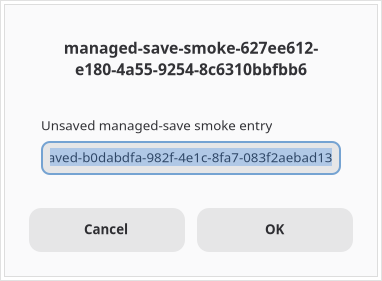

# Idle hibernation with libvirt managed save

[Issue #57](https://github.com/mieweb/ozwell-computer/issues/57) tracks the objective:
stop an unused Ozwell computer completely, release its executing guest processes
and their RAM, then restore its running applications and unsaved state when a
client returns. This experiment tests the underlying VM lifecycle. It does not
implement a libvirt provider, automatic idle detection, or a wake gateway.

`virsh managedsave DOMAIN --running` saves a running VM and stops it. Ordinary
`virsh start DOMAIN` consumes that managed save and resumes the same guest state.
This differs from `virsh suspend`, which retains the VM in memory. Saved state
includes RAM and device state; it does **not** snapshot the guest disks. Preserve
the same writable disk images unchanged while the VM is saved. Do not attach them
to another writer or use `start --force-boot`, which discards the saved state.
See the official [managedsave](https://www.libvirt.org/manpages/virsh.html#managedsave),
[save](https://www.libvirt.org/manpages/virsh.html#save), and
[start](https://www.libvirt.org/manpages/virsh.html#start) documentation.

The resource objective applies to each sleeping guest: its QEMU process disappears
while saved. Libvirt, an external controller, and the host remain active; cached
save-file pages can remain in reclaimable host memory. Network connections and
remote authentication sessions may expire during the interruption.

## Reproduce the disposable lab

Requirements: Docker, network access for package downloads, and an **existing local
linux/amd64 Ozwell image**. The default image is `ozwell-computer:dev`. The lab
uses that image's actual Ozwell installation and desktop applications, adds a Linux
kernel/initramfs in a temporary source container, and exports its root filesystem
into an ext4 disk. Before direct kernel boot through QEMU/libvirt, it removes
Docker's guest-detection marker files, configures static networking by discovering
the real guest interface, and installs boot diagnostics that write to the serial
log.

```bash
OZWELL_COMPUTER_IMAGE=ozwell-computer:dev \
  bash scripts/libvirt-managedsave-lab.sh /tmp/ozc-managedsave-results
```

The wrapper pulls `node:24-bookworm-slim` if needed and downloads Debian libvirt,
QEMU, filesystem tools, and guest kernel packages. It creates a privileged Linux
lab container limited to 6 GiB RAM and six CPUs; the guest has 2 GiB RAM, two vCPUs,
and an 8 GiB sparse root disk. Additional disk space is needed for the exported
root filesystem, package downloads, and saved memory. No host directories,
libvirt sockets, or existing VM disks are mounted. The container is privileged;
this is a disposable local test environment, not a security-isolation design.

The guest is an x86_64 VM using QEMU software emulation (TCG), with user-mode
networking and an HTTP forward bound to the lab container's loopback interface.
Its explicit `Nehalem` CPU model exposes SSE4.2: the default `qemu64` model caused
an invalid-opcode failure in libvips during screenshot rendering. SSE4.2 is a
documented requirement for the
[prebuilt Linux x64 sharp/libvips binaries](https://sharp.pixelplumbing.com/install/#prebuilt-binaries).
The wrapper calls the smoke test with `--require-gui` and two save/restore cycles.
This establishes lifecycle behavior for the recorded configuration. It is not a
KVM/HVF compatibility result or a hardware-accelerated performance benchmark.

The output directory contains `source-image.json`, host and guest installation
logs, `boot-files.sha256`, `domain.xml`, `serial.log`, `results.json`, and GUI PNGs
when those stages are reached. `gui-before.png` captures the initial entry;
`gui-after-1.png` and `gui-after-2.png` capture it after each restore. The JSON records
versions, domain/guest UUIDs, process and disk identity, before/after application
state, timings, QEMU RSS, save-image size when readable, and screenshot sizes and
hashes. Treat startup logs as potentially containing the temporary access token;
redact them before sharing or committing artifacts.

**Cleanup:** on every normal or error exit, the wrapper attempts to copy evidence
and removes its source and lab containers, including the VM disk and any saved
state. The original local image is unchanged. If interrupted in a way that prevents
the shell's EXIT trap from running, remove the temporary `ozc-managedsave-lab-*`
and `ozc-managedsave-source-*` containers manually.

## Test an existing disposable VM

Run the smoke script on the Linux libvirt host where QEMU appears in `/proc`.
The domain must already be persistent, running, and backed by a readable local
file disk; its Ozwell HTTP endpoint must allow the exec API. The guest needs
Python 3 and readable `/sys/class/dmi/id/product_uuid`, or passwordless `sudo -n cat`
access to that file. UUID comparison verifies that the endpoint belongs to the
selected VM before starting test applications or saving it. This initial smoke
test requires guest DMI and is not portable to every VM architecture.

For GUI evidence, the guest also needs zenity, a working X desktop, and Ozwell's
keyboard, clipboard, window, and PNG screenshot APIs, with XFIXES selection events
to track clipboard generations. AT-SPI accessibility support is not required.
This test deliberately activates its window and changes the
foreground clipboard; run it on a disposable desktop without another interactive
session. Export the endpoint's access token in your shell without placing it in
command arguments:

```bash
node scripts/smoke-libvirt-managedsave.mjs \
  --uri qemu:///system \
  --domain disposable-ozwell-vm \
  --url http://guest-host:8080 \
  --token-env OZWELL_COMPUTER_TOKEN \
  --cycles 2 --sleep-ms 5000 --require-gui \
  --output /tmp/ozwell-managedsave-results.json
```

The script holds a random token, an advancing counter, and 64 MiB of nonzero data
in a detached Python process. It creates a zenity entry, edits it through the
native keyboard API once, and leaves its text unsaved. To read the real widget,
each verification first writes a fresh unrelated clipboard sentinel and reads it
back, then activates the entry and sends Ctrl+A/C. It requires the expected marker
and a newer clipboard generation. This avoids a stale clipboard false pass and
does not depend on GTK's accessibility text values. The marker is never retyped
after a restore. Each cycle verifies:

- Shutoff state, a managed save, and no QEMU process for the domain during the wait.
- The same disk paths/inodes, with unchanged disk metadata throughout the saved wait.
- Restoration through ordinary `virsh start`, followed by the same boot ID, guest
  process PID/start time, RAM token, recomputed payload hash, and advancing counter.
- The same GUI window/process and unsaved text when GUI verification is required.
- A PNG screenshot with the expected signature after restoration, with a screenshot
  captured before the first save as the baseline.

The smoke script removes only its own temporary processes after success and leaves
the VM running. On failure it records the error and never discards a save or falls
back to a cold boot; a saved guest can therefore remain stopped for inspection.
This preservation behavior differs deliberately from the disposable lab wrapper's
complete cleanup. Omitting `--require-gui` permits a RAM-only run and records why
GUI verification was skipped.

## Results

The complete disposable-lab command passed on **2026-10-31**, including both
save/restore cycles, fresh clipboard verification, and PNG capture after each
restore. The wrapper copied its evidence and removed its VM/source containers.

The host was Apple Silicon running an ARM64 OrbStack Linux VM; the guest was
x86_64 under TCG with the explicit Nehalem CPU model. Recorded versions were
libvirt 9.0.0, QEMU 7.2.22 (`Debian 1:7.2+dfsg-7+deb12u18+b3`), and guest Debian
13.1 with kernel `6.12.113+deb13-amd64`. The tested Ozwell package was
`2026.10.2+1.g158f71c.dirty` from local image
`sha256:3c8a5af4e2f818fa49d5f396c2c2e6f5cc66bfcac462d6cc95859e8cc3523dd0`.
The guest workload came from this existing local image; repository checks ran
against the updated PR base.

| Cycle | Save | Restore to HTTP ready | Save image | QEMU process while saved |
|---|---:|---:|---:|---|
| 1 | 0.896 s | 0.592 s | 894.8 MiB | None |
| 2 | 0.824 s | 0.450 s | 897.8 MiB | None |

Each saved interval lasted about five seconds. Both had `shut off (saved)` status,
a managed-save image, no QEMU process matching the VM UUID, and unchanged disk
identity/metadata. Before the first save QEMU RSS was
2.09 GiB; there was no domain QEMU process retaining that allocation while saved.
This does not measure or eliminate reclaimable host page cache.

The guest boot ID, RAM probe PID/start time, random probe token, and recomputed
64 MiB payload SHA-256 remained identical; the counter continued advancing.
The zenity window and process (PID 704, start tick 5643) and the exact unsaved
entry text survived both restores. The initial and both restored GUI PNGs were
**byte-identical**, SHA-256
`591d9f4f50b18838ebc01a567dcc7a48ca8ace2180cf5e070021b2234dedcf3f`.

Inspect the [raw results](experiments/libvirt-managed-save/results.json),
[source image identity](experiments/libvirt-managed-save/source-image.json), and
[boot-file hashes](experiments/libvirt-managed-save/boot-files.sha256).
The probe token in the JSON is synthetic RAM test data; the actual access token
is excluded. PNGs are available [before save](experiments/libvirt-managed-save/gui-before.png),
[after cycle 1](experiments/libvirt-managed-save/gui-after-1.png), and
[after cycle 2](experiments/libvirt-managed-save/gui-after-2.png).



These cached local I/O timings are observations from one small software-emulated
desktop, not KVM/HVF production performance estimates. Long idle intervals,
remote-session survival, browser workloads, VNC streaming, host reboot/crash,
and host/CPU/QEMU upgrades remain untested. Repository validation passed
`npm run typecheck`, all 166 unit tests, and `npm run build` on the updated branch.

## Production follow-up

The orchestrator provider contract already exposes `start()` for stopped computers,
and MCP calls can start them before forwarding. Viewer URLs point directly at
computers. A libvirt provider still needs managed-save/resume semantics and saved
state tracking, plus an external authenticated wake gateway for viewer and direct
API requests. Keep connection/activity leases outside the VM, exclude
health/metrics polling, and sleep only after a grace period with no viewers,
terminals, in-flight work, or jobs explicitly keeping the computer awake.

Serialize save/resume transitions per computer so concurrent arrivals share one
restore, wait for Ozwell readiness, and then forward traffic. Preserve ownership,
tokens, URLs, disks, and saved memory across controller restarts. A restore failure
must remain visible instead of silently cold-booting away unsaved application
state. These changes and accelerated-host validation remain work for issue #57.
