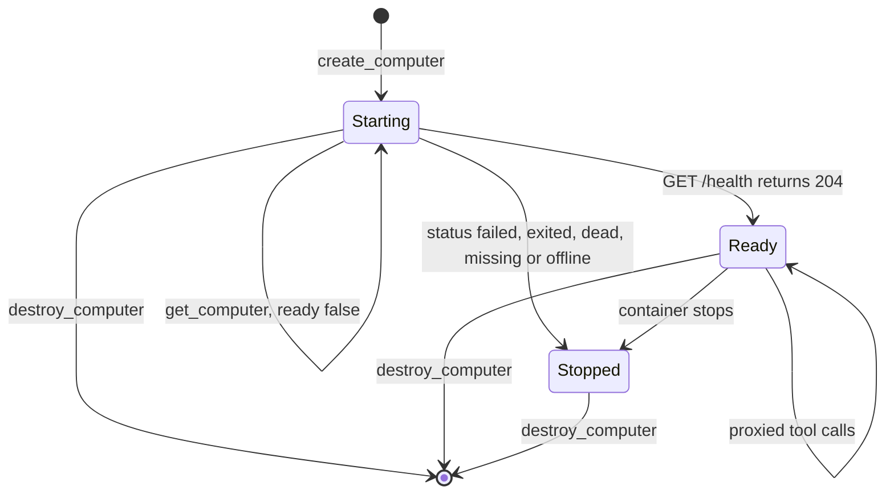
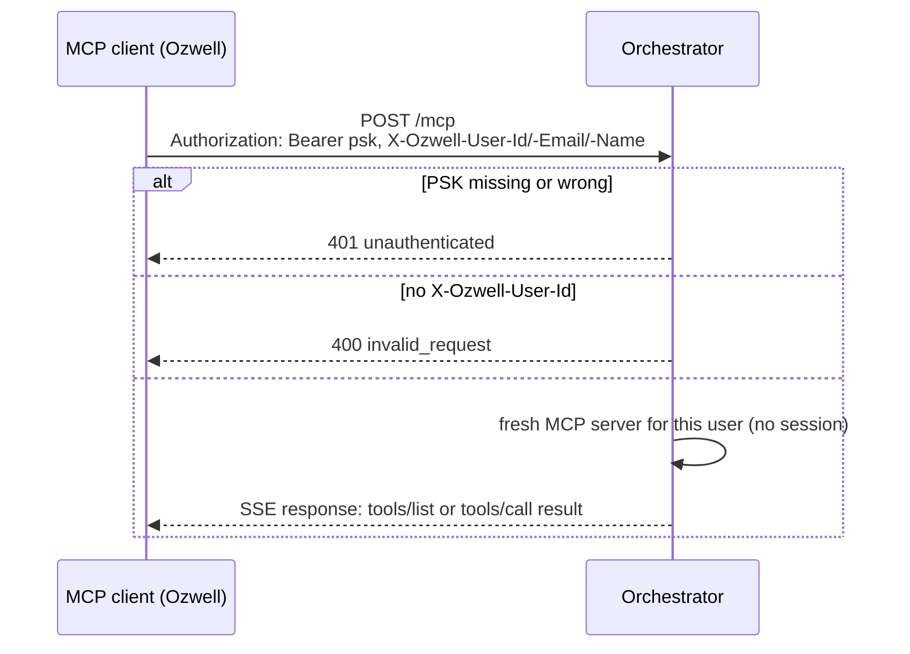
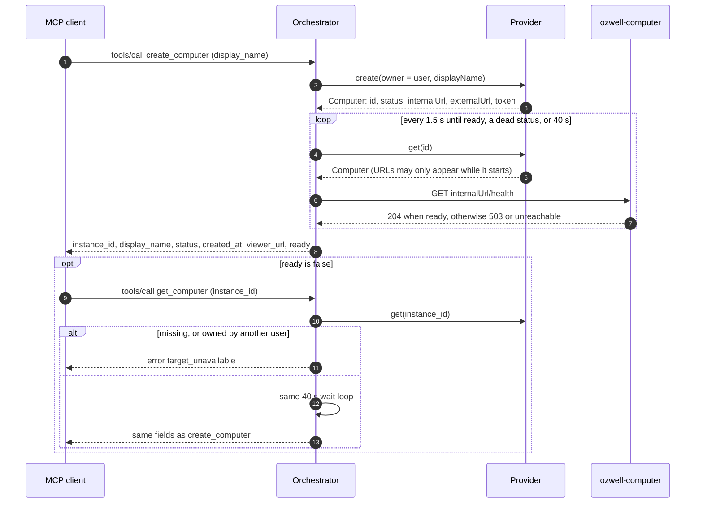
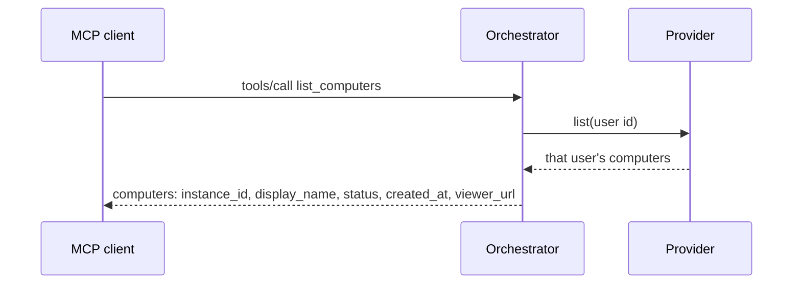
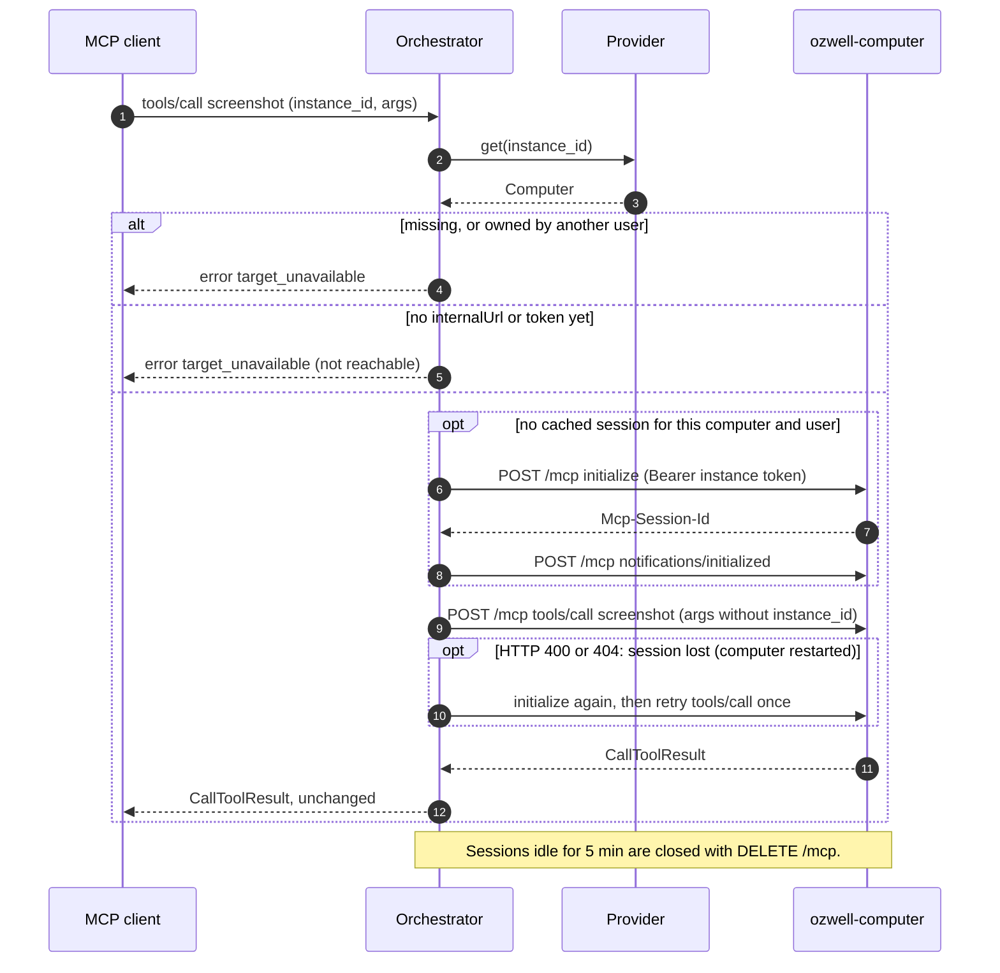
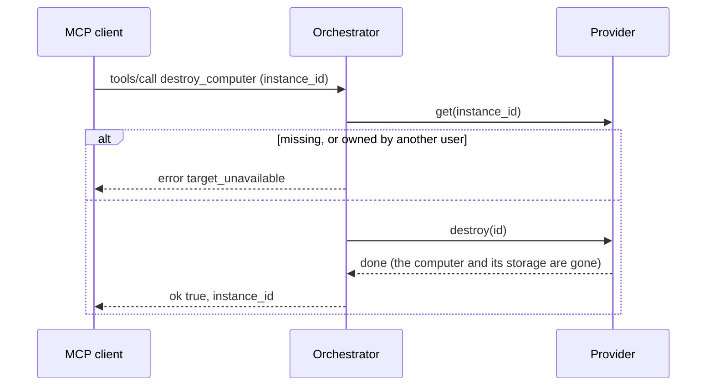
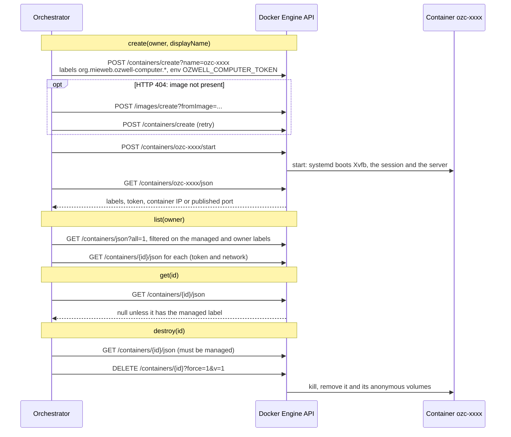
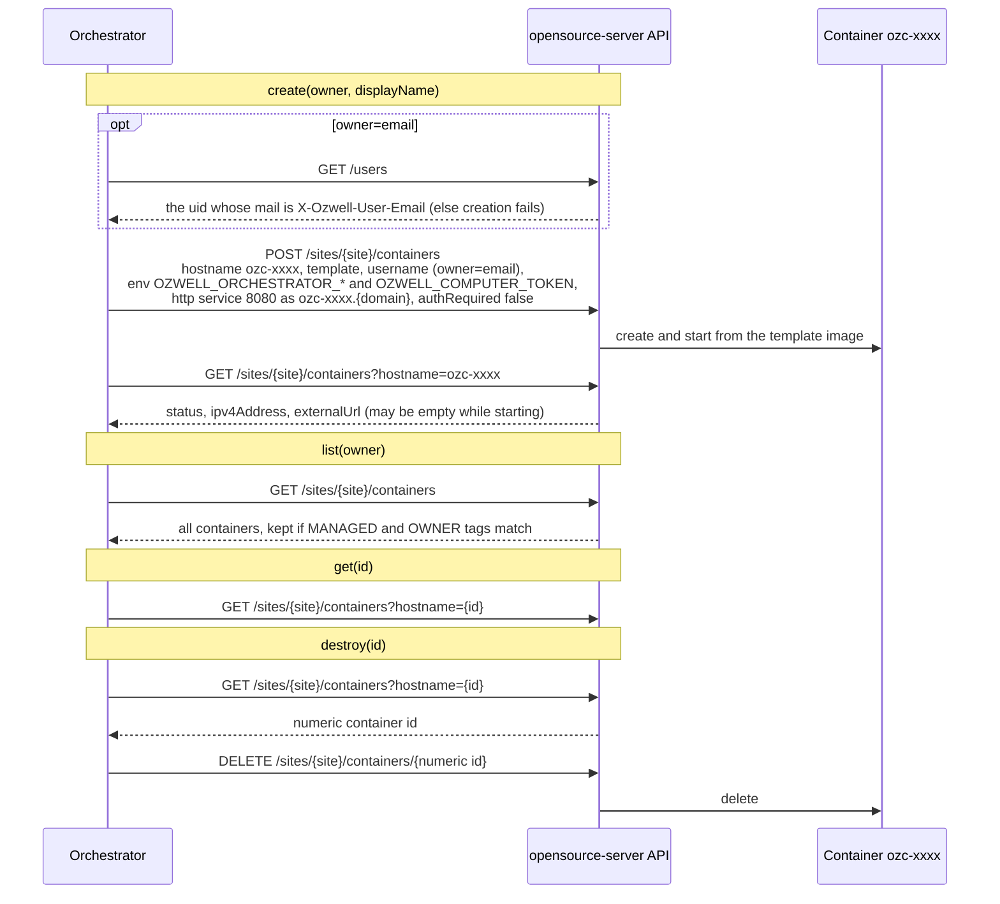

# ozwell-computer-orchestrator

One MCP endpoint for a whole Ozwell workspace that gives every user their own
ozwell-computers. It creates, lists and destroys computers through a pluggable
provider, and proxies every ozwell-computer tool with an extra `instance_id` argument.

## How it works

- **Stateless.** Every MCP request is handled independently. Who owns which computer,
  their metadata, URLs and access token all live in the provider (for Docker: container
  labels and env), so restarting or replicating the orchestrator loses nothing.
- **Per user.** Ozwell calls with one workspace-wide configuration, plus
  `X-Ozwell-User-Id` (required), `X-Ozwell-User-Email` and `X-Ozwell-User-Name`. Every
  tool is scoped to that user id: other users' computers are reported as not found.
  These headers are only trusted on requests carrying the pre-shared key.
- **Tools.**
  - Management: `list_computers`, `create_computer`, `get_computer` and
    `destroy_computer`. `create_computer` takes an optional `display_name`. It and
    `get_computer` wait up to about 40 s for the computer to start, then return
    `ready: false` if it is still starting (under the 60 s MCP client limit); the agent
    calls `get_computer` again. They return `instance_id` and
    `viewer_url`, which embeds the computer's token for the user to open.
  - Quota: with `ORCHESTRATOR_MAX_INSTANCES` set, `create_computer` fails with
    `quota_exceeded` once the user has that many computers (counted from the provider,
    whatever their status). The error lists them and tells the agent to reuse one, or to
    `destroy_computer` one only after the user explicitly agrees.
  - Proxied: every tool in `../docs/mcp-tools.json` with `instance_id` added. That
    catalog is generated from the computer (`npm run mcp-tools` at the repo root), so
    the orchestrator knows the tools without a running instance.

## Computer lifecycle

As the agent sees it. The orchestrator stores none of this: readiness is worked out on
each call from the provider's status and the computer's `GET /health` (204 once its X
display is connected).



Every request is a stateless `POST /mcp` with Ozwell's headers. The orchestrator checks
them before any tool runs:



### create_computer and get_computer



`viewer_url` is `externalUrl/?token=...`: the user opens it to watch or take over.

### list_computers



No readiness check: `status` is the provider's own.

### Proxied tool calls

Any tool from `docs/mcp-tools.json` (`screenshot`, `click`, `run_command`, ...):



The session's client name is the user's name, so the agent appears under it in the
viewer.

Each proxied call has an 11-minute HTTP timeout; that is not a command limit.
`run_command` waits at most 50 s (`wait_ms`, default 25 s), then returns the still-running
job, which the agent follows with `command_output`. The command itself may run for up
to 24 hours (`timeout_ms`, default 1 hour).

### destroy_computer



## Run

```bash
npm ci
cp .env.example .env   # then edit
npm start
```

`npm start` reads `orchestrator/.env` if it exists (git-ignored). Variables already set in
the environment take precedence.

| Variable | Default | |
|---|---|---|
| `PROVIDER_URI` | (required) | provider and its settings; the scheme selects the provider |
| `ORCHESTRATOR_TOKEN` | (required) | pre-shared key; Ozwell sends `Authorization: Bearer <psk>` |
| `ORCHESTRATOR_AUTH_DISABLED` | `false` | development only: no PSK, so any caller can claim any user |
| `ORCHESTRATOR_HOST` / `ORCHESTRATOR_PORT` | `127.0.0.1` / `8090` | listen address |
| `TOOL_CATALOG` | `../docs/mcp-tools.json` | proxied tool definitions |
| `ORCHESTRATOR_MAX_INSTANCES` | unlimited | computers each user may have |
| `COMPUTER_FRAME_ANCESTORS` | none | origins (e.g. `https://app.ozwell.ai`) allowed to embed the viewer in an iframe; passed to computers when they are created as `OZWELL_COMPUTER_FRAME_ANCESTORS`, so existing computers keep their value |
| `LOG_LEVEL` | `info` | |

Configure Ozwell's workspace MCP server as `http(s)://<orchestrator>/mcp` (Streamable
HTTP) with the header `Authorization: Bearer <psk>`. Put TLS in front of it.

## Providers

`PROVIDER_URI`'s scheme selects a provider (`src/providers/index.ts`). The rest of the
URI, and the environment, are passed to it. A provider implements `list(owner)`,
`get(id)`, `create({ owner, displayName })` and `destroy(id)`. Each computer reports:
- `id`: provider-generated and DNS-compatible;
- `owner` and metadata;
- `status`;
- `internalUrl` (orchestrator → instance) and `externalUrl` (given to users);
- `token`.

### `docker` (reference)

```
docker:///var/run/docker.sock                  local daemon
docker://host:2375                             remote daemon (plain TCP)
  ?image=ghcr.io/mieweb/ozwell-computer:latest image (pulled if missing)
  &network=<name>                              network to attach to
  &publish=1&publish_host=<host>               publish 8080 on a random host port and use
                                               http://<publish_host>:<port>; otherwise the
                                               container's IP is used for both URLs
```

Containers are named `ozc-<random>` and labelled `org.mieweb.ozwell-computer.*` (owner,
display name, email, user name, created). The token is in the container's environment.
It's a reference implementation: it uses the same systemd settings as `compose.yml`,
applies no resource limits, and anyone with the Docker socket can read every token.



`status` is Docker's container state (`created`, `running`, `exited`, ...). Both URLs
are `http://<container IP>:8080`, or `http://<publish_host>:<host port>` with `publish=1`.

### `opensource-server`

```
opensource-server://manager.os.mieweb.org?site=<id>&domain=<external domain id>
  &template=ghcr.io/mieweb/ozwell-computer:latest
  &owner=tag|email
  &internal=external|ip
  &tls=0                                        (http, development only)
```

The API key comes from `OPENSOURCE_SERVER_API_KEY`.
- **Container:** each computer is an opensource-server container named `ozc-<random>`,
  with an `http` service on port 8080 published as `https://ozc-<random>.<domain>`.
  `authRequired` is off, because the computer has its own token.
- **Ownership:** it is always enforced by the Ozwell user id, kept in environment-variable
  tags (`OZWELL_ORCHESTRATOR_*`) next to `OZWELL_COMPUTER_TOKEN`. That is the only
  free-form metadata the API has.
  - `owner=tag` (default): containers belong to the API key's account.
  - `owner=email`: each container is also attributed to the opensource-server user whose
    email matches `X-Ozwell-User-Email`, so it appears in their dashboard. This needs an
    admin key, and creation fails for users without an opensource-server account.
- **Internal URL:** `internal=external` (default) reaches computers through their public
  URL. `internal=ip` uses `http://<ipv4>:8080`, for an orchestrator running on the
  site's network.
- **Note:** an admin key lists every container on the site; non-orchestrator containers
  are ignored.

The paths below are relative to the API base `/api/v1`, e.g. `GET /users` is
`GET /api/v1/users`.



`status` is opensource-server's. The orchestrator polls `/health` on the internal URL
(`https://ozc-xxxx.<domain>` or `http://<ipv4>:8080`) until the computer answers.
